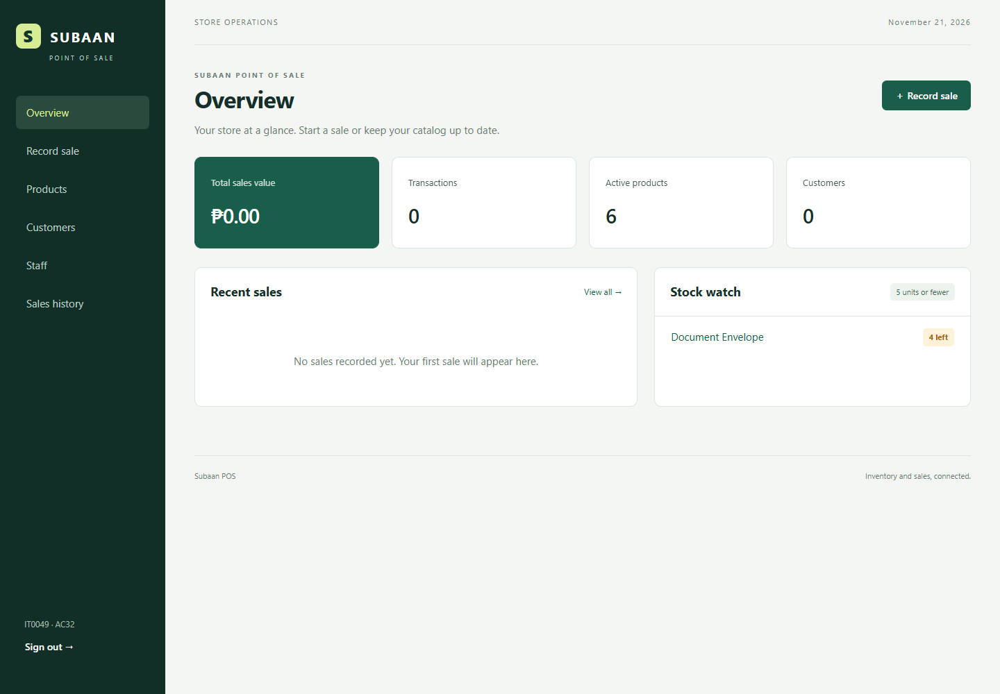

# Subaan Point of Sale

Complete IT0049 midterm project for **Oracle M. Subaan**, section **AC32**, professor **Mr. Santos**.

CodeIgniter 4.7.6 application with a relational database, staff authentication, product/customer/staff management, prepared image uploads, stock-safe sales and joined transaction history. The interface works on desktop and mobile, uses Philippine pesos, and displays timestamps in Asia/Manila.

## Run the prepared local copy

The unpacked project in this delivery already includes installed dependencies and a local database. Open `http://localhost:8080/` while its development server is running. The separate `START-HERE.txt` contains the locally generated credentials. Those credentials and the database are excluded from the source ZIP and Git.

To restart on this Windows machine:

```powershell
powershell -ExecutionPolicy Bypass -File .\run.ps1
```

The script enables missing intl, GD and SQLite3 extensions for this process, migrates the database and serves `public/`. It uses `writable/tmp` for upload temporary files. It does not change your global PHP configuration.

## Clean installation from source

Requirements: PHP 8.2 or newer, Composer 2, and the intl, mbstring, bcmath, gd, fileinfo, sqlite3 and session extensions. Enable ZIP as well when using Composer without an unzip utility. MySQL deployments also require mysqli. PHP's GD build must support JPEG, PNG and WebP. Enable the extensions in php.ini before invoking Composer. For XAMPP, use its PHP configuration and restart Apache after configuration changes.

```powershell
composer install --no-dev --prefer-dist
Copy-Item .env.example .env
php spark migrate
php spark pos:staff
php spark db:seed DemoSeeder
powershell -ExecutionPolicy Bypass -File .\run.ps1
```

`pos:staff` asks for a username, full name and password. Use 12–72 characters for passwords. It stores a password hash, never a plaintext password. The CLI prompt is visible, so create the account in a private terminal. The optional `DemoSeeder` adds six stationery products with prices and stock. It creates no customer identities, transactions or shared passwords, and skips a nonempty product catalog. Skip that command for an empty store.

On Linux/macOS, copy `.env.example` to `.env`, run the same Composer/migration/account commands, and start development with:

```sh
php -S localhost:8080 -t public vendor/codeigniter4/framework/system/rewrite.php
```

## MySQL database

SQLite is the default for immediate local use. The provided migration supports MySQL/MariaDB and preserves the four required tables and all relationships. Create a database named `subaan_pos`, configure these nonsecret values in `.env`, and set the database username/password to the actual credentials assigned by your server:

```ini
database.default.DBDriver = MySQLi
database.default.database = subaan_pos
database.default.hostname = 127.0.0.1
database.default.port = 3306
```

Then run `php spark migrate` and `php spark pos:staff` against that database. MySQL tables use InnoDB so stock updates and sales inserts participate in the same transaction. Do not copy the SQLite file into MySQL. Local verification in this delivery used SQLite; MySQL and Docker execution have not been verified on this machine.

## Use the application

1. Sign in with an active staff account.
2. In **Products**, add a product name, price and nonnegative whole-number stock. An image is optional. Edit products to replenish stock. Archive removes a product from the active catalog and sale selectors.
3. In **Customers**, create or update a name, valid email and optional phone number. Delete removes the customer from active lists while preserving previous sales relationships.
4. In **Staff**, create accounts, change names or passwords, and upload an avatar. An empty password during editing preserves the existing hash. You cannot delete the account you are currently using. All staff have management access, as required by the assignment; there is no separate administrator role.
5. In **Record sale**, choose an in-stock product, optionally choose a customer, enter a positive quantity, and record the sale. The server uses the stored price and signed-in staff ID. The summary is an estimate; the committed transaction uses the price at submission.
6. **Sales history** shows product, customer or walk-in, staff, quantity, total and date. Sales are permanent and cannot be edited or deleted through the interface.

Deletion is implemented with `deleted_at` for customers and staff, and archiving for products. These records are hidden from active operations, retain their IDs for foreign keys, and remain available to historical joins. Names in history reflect the current related record name; the quantity and sale total are immutable stored values. Existing sessions for deleted staff are rejected on their next protected request.

## Architecture and security

`app/Config/Routes.php` declares the route surface with auto-routing disabled. Auth filters protect every management, sale and media route. CSRF protection applies to POST requests, session IDs regenerate on login, login attempts are limited per IP, output is escaped, writes use models/query builders, and passwords use PHP password hashing. The throttle uses CodeIgniter's file cache and is intended for a single application instance.

Controllers handle HTTP input and validation; models handle persistence and queries; views render escaped HTML. Shared `ImageUpload` and `SaleRecorder` libraries isolate media processing and transactional sale logic. A migration creates the database schema and a seeder supplies the optional catalog. See `docs/architecture.md` for relationships and flow.

`SaleRecorder` begins a database transaction and conditionally decrements stock only when the requested quantity is available. This database write prevents two sale requests from both consuming the same units. It then reads the locked product price, computes an exact decimal total with BCMath, and inserts the sale. Any error rolls back the stock change. Totals above DECIMAL(10,2)'s limit are rejected. One-use session form tokens prevent accidental duplicate checkout submissions from the same session. CSRF tokens regenerate after each POST, so an old browser tab may require a reload.

Images are restricted to JPEG, PNG and WebP, at most 2 MB, 16 megapixels, and 6000 pixels per side. GD re-encodes them to JPEG under random filenames in `writable/uploads`, outside the public document root. Product images fit within 1000 × 1000 pixels; avatars are cropped to 256 × 256. Authenticated media delivery sets a fixed JPEG content type. The original upload is never served. Transparent images become JPEG and do not retain transparency. Replaced images are retained on disk; remove unreferenced files during planned maintenance.

## Verification

The automated HTTP workflow completed 37 checks, including CRUD, validation, image processing and private image delivery, blocked executable uploads, sign-in/sign-out, CSRF rejection, exact sale totals, stock preservation after rejection, duplicate submission protection and history after logical deletion. See `docs/test-results.json` and `docs/verification.md` for the checks and limitations.

To repeat against a **disposable local database**, install Python 3 and Pillow, start the application and provide `TEST_USERNAME`, `TEST_PASSWORD`, and optionally `BASE_URL` to `python tests/http_integration.py`. This is a real HTTP integration suite: it creates records, records sales and logically deletes its fixtures. Restore a database backup afterward. It writes `test-results.json` in the current directory. Never run it against a live store.

## Deployment

Use a PHP/Apache host with persistent storage. The Apache document root must be the project's `public/` directory, with mod_rewrite and AllowOverride enabled. Keep `.env`, `app/`, `vendor/` and `writable/` outside the web root. Set `CI_ENVIRONMENT = production`, set `app.baseURL` to the actual HTTPS origin, configure the database, make only `writable/` writable by the web server, run `composer install --no-dev`, `php spark migrate`, and `php spark pos:staff`. Use a private staff password and HTTPS. Back up both the database and uploaded media.

The included Dockerfile provides PHP 8.2/Apache and required extensions. For local Docker use:

```sh
docker compose up --build -d
docker compose exec --user www-data pos php spark migrate
docker compose exec --user www-data pos php spark pos:staff
docker compose exec --user www-data pos php spark db:seed DemoSeeder
```

The named volume retains SQLite, sessions and images. On a real host, set the actual HTTPS base URL instead of localhost. Keep SQLite deployments to one server instance with a persistent local filesystem. Use MySQL for a database shared across instances. A host with an ephemeral filesystem will lose SQLite data and uploads without persistent storage.

## Submission status

The raw source, Composer lockfile, migration, seeder, launch script, Docker configuration and documentation are included. The unpacked local project runs at `http://localhost:8080/`; this is not a hosted submission URL.

Source repository: [clayinthesky/subaan-pos](https://github.com/clayinthesky/subaan-pos). The repository is private; the owner must grant access to anyone reviewing the submission.

A hosted public application link remains pending. The local development URL is not a hosted submission URL. Deploy this project to a PHP-capable host with persistent storage, then submit its actual HTTPS link together with the repository link. See `docs/deployment.md` for the release procedure.

## Framework references

- [CodeIgniter Composer installation](https://codeigniter.com/user_guide/installation/installing_composer.html)
- [Models](https://codeigniter4.github.io/userguide/models/model.html)
- [Validation](https://codeigniter4.github.io/userguide/libraries/validation.html)
- [Controller filters](https://codeigniter4.github.io/userguide/incoming/filters.html)
- [Database transactions](https://codeigniter4.github.io/userguide/database/transactions.html)
- [Image manipulation](https://codeigniter4.github.io/userguide/libraries/images.html)

## Application preview


