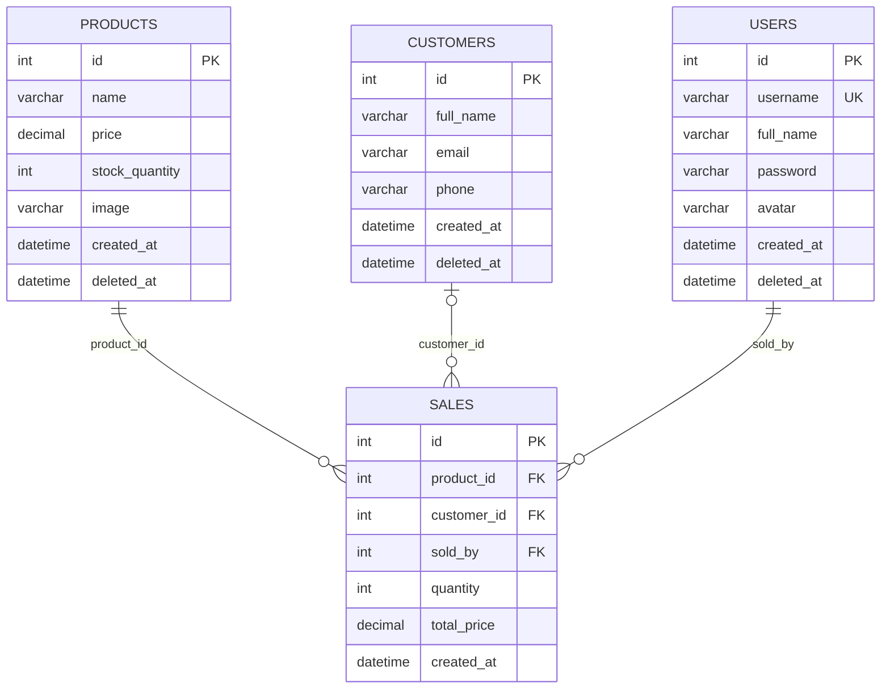

# Application design

The system connects an active staff session to a catalog, customer records and permanent sales. Four tables preserve the assignment's original IDs, fields and relationships. Product, customer and user tables add nullable `deleted_at` timestamps so logical deletion does not break historical foreign keys.

Each sale contains one product, as specified by the assignment schema. Customer ID is nullable for walk-ins. Sale quantity and total are stored at checkout; changing a product's current price does not recalculate earlier totals. Foreign keys restrict physical deletion of referenced records.

## Request flow

1. The explicit route dispatches through CSRF and, for protected pages, the authentication filter.
2. Authentication reloads the active staff record for the session ID, rejecting deactivated accounts.
3. Management controllers whitelist and validate fields before passing data to models. Images go through the upload library before persistence.
4. A sale submission validates IDs, positive quantity and the one-use sale form token.
5. The sale library begins a transaction, validates the customer/staff references, and executes a conditional stock decrement. A failed update rejects the sale.
6. After the row is locked, the library reads the product price, computes total with BCMath and inserts the sale. Commit makes both changes permanent; exceptions roll both back.
7. Controllers redirect with a clear result message. Views escape output and include CSRF fields on state-changing forms.

## Module locations

| Requirement | Implementation |
| --- | --- |
| Explicit routes and protected management | `app/Config/Routes.php`, `app/Filters/AuthFilter.php` |
| Products, customers, staff CRUD | `app/Controllers/Management.php`, `app/Models/*Model.php`, `app/Views/management/` |
| Login and logout | `app/Controllers/Auth.php`, `app/Views/login.php` |
| Display-ready uploads | `app/Libraries/ImageUpload.php`, `app/Controllers/Media.php` |
| Atomic sale and inventory | `app/Libraries/SaleRecorder.php`, `app/Controllers/Sales.php` |
| Joined, paginated history | `app/Models/SaleModel.php`, `app/Views/sales/history.php` |
| Database installation | `app/Database/Migrations/2026-11-21-000001_CreatePos.php` |
| Optional catalog | `app/Database/Seeds/DemoSeeder.php` |
| First account | `app/Commands/CreateStaff.php` |

Price/total fields retain DECIMAL(10,2) for MySQL. SQLite uses its numeric affinity; the application formats and validates prices and calculates sale totals with decimal string arithmetic rather than floating-point multiplication. Stock is an integer and cannot be negative through supported application forms.
